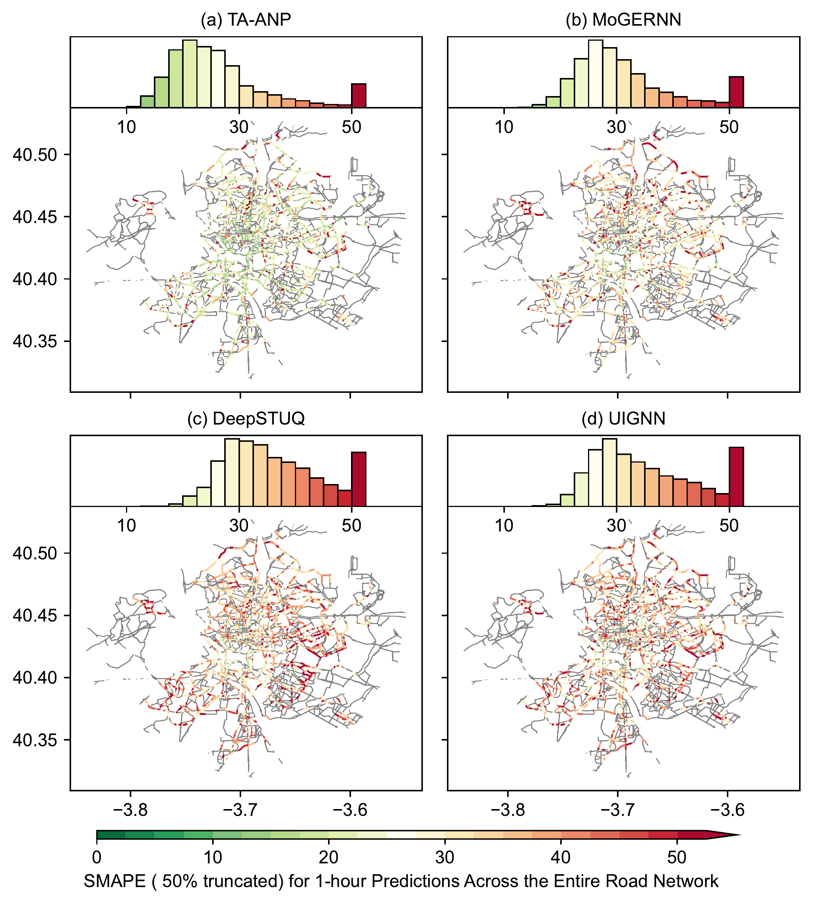
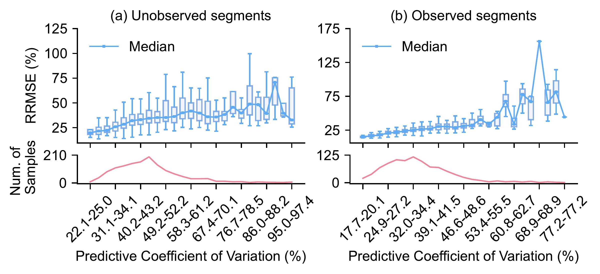
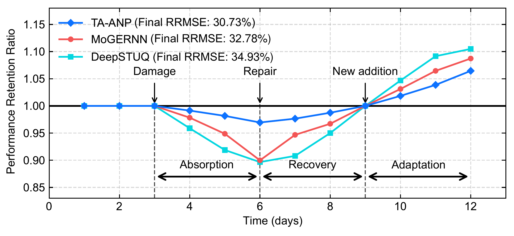
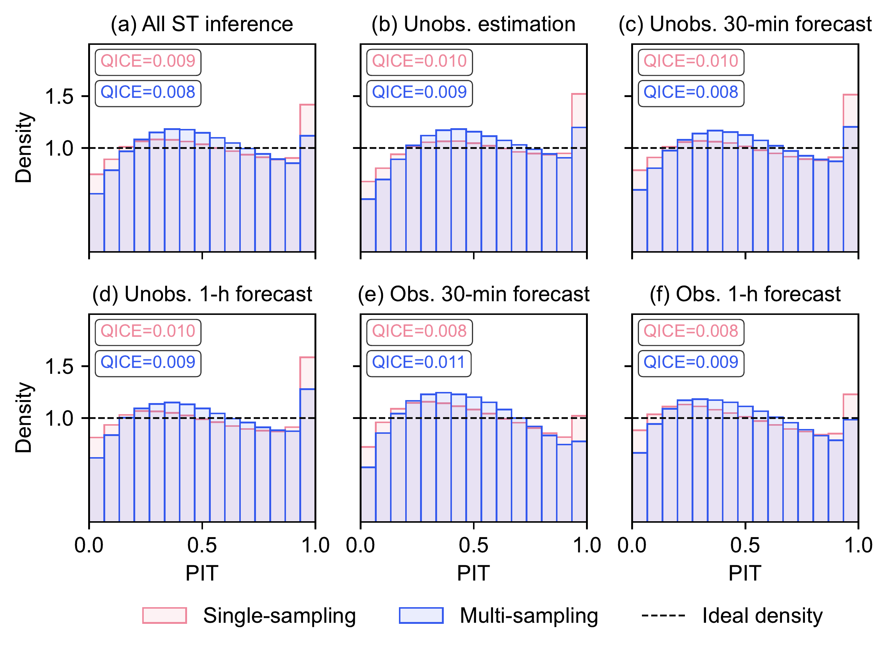

# TA-ANP

This repo is the official implementation of [**Metropolis-scale resilient and trustworthy traffic flow inference using multi-source data**](https://doi.org/10.1016/j.trc.2026.106083) in *Transportation Research Part C: Emerging Technologies*.

## Overview

How can we reliably infer traffic flow at unobserved locations as fixed sensors fail or new sensors are deployed?

**TA-ANP** combines sparse fixed-sensor measurements with floating car data to estimate and forecast traffic flow across a city. It quantifies prediction uncertainty and adapts to sensor failures, repairs, and new deployments without retraining.

## Usage

Run the following steps from the repository root.

**Pretrained checkpoint:** The [seed-42 weights](check_points/original_pretrained/seed_42/best_train_checkpoint.pth) are included. After preparing the environment and data, run `bash scripts/reproduce_pretrained.sh` for K=30 inference without training.

### 1. Create the Conda environment

The environment uses the original experiment versions: Python 3.11.11 and PyTorch 2.6.0 with CUDA 11.8 (Linux x86_64).

```bash
conda env create -n taanp -f environment.yml
conda activate taanp
```


### 2. Prepare the data

Follow the [data preparation instructions](data_preparation/README.md).

### 3. Train and evaluate

```bash
bash scripts/train_taanp.sh
bash scripts/inference_taanp.sh
```

These commands train TA-ANP and evaluate its best training checkpoint with K=30. Outputs are saved to `outputs/taanp/`. To evaluate another checkpoint, pass its path to `bash scripts/inference_taanp.sh /path/to/checkpoint.pth`.

## Main Results



**Spatial distribution and histogram of SMAPE (%) for 1-hour-ahead prediction over the entire road network.** Each subfigure reports the SMAPE histogram (top; values above 50% are truncated) and the corresponding spatial heatmap (bottom; green to red indicates low to high error).



**Relationship between the predictive coefficient of variation (PCV, %) and relative root mean square error (RRMSE, %) for TA-ANP (1-hour-ahead global inference).** Panels correspond to (a) unobserved and (b) observed road segments. In each panel, the upper plot shows the distribution of RRMSE within each PCV bin (box plots) with the median connected by a line, and the lower plot reports the corresponding sample counts.



**Resilience of flow inference under a Damage–Repair–Addition lifecycle of the fixed-sensor network.** The y-axis reports the performance retention ratio, defined as $(1/\mathrm{RRMSE})/(1/\mathrm{RRMSE}_{\mathrm{base}})$; thus $y=1$ indicates the disturbance-free baseline. Vertical dashed lines separate the three stages. Legends report final RRMSE values at day 12.



**Probability integral transform (PIT) histograms comparing uncertainty calibration obtained with single-sampling (one stochastic forward pass; red) and multi-sampling (30 Monte Carlo dropout samples; blue) across six settings:** (a) All spatiotemporal (ST) points inference. (b) Unobserved (Unobs.) estimation. (c) Unobs. 30-min forecast. (d) Unobs. 1-h forecast. (e) Observed (Obs.) 30-min forecast. (f) Obs. 1-h forecast. The dashed line indicates the ideal uniform density; QICE is reported in each panel (lower is better).

## Citation

If you use this work, please cite:

Qishen Zhou, Yifan Zhang, Michail A. Makridis, Anastasios Kouvelas, Yibing Wang, and Simon Hu. Metropolis-scale resilient and trustworthy traffic flow inference using multi-source data. *Transportation Research Part C: Emerging Technologies*, 194, 106083, 2027. [https://doi.org/10.1016/j.trc.2026.106083](https://doi.org/10.1016/j.trc.2026.106083).

```bibtex
@article{zhou_taanp,
  title   = {Metropolis-scale resilient and trustworthy traffic flow inference using multi-source data},
  author  = {Zhou, Qishen and Zhang, Yifan and Makridis, Michail A. and Kouvelas, Anastasios and Wang, Yibing and Hu, Simon},
  journal = {Transportation Research Part C: Emerging Technologies},
  volume  = {194},
  pages   = {106083},
  year    = {2027},
  doi     = {10.1016/j.trc.2026.106083},
  url     = {https://doi.org/10.1016/j.trc.2026.106083}
}
```


Please also cite the [MMTD dataset record](https://doi.org/10.5281/zenodo.18781181) when using its data.

## Acknowledgement

We thank the Madrid City Council (Ayuntamiento de Madrid) for making the fixed-sensor traffic data publicly available, and TomTom for providing the floating car traffic data used in this study.

## License

A code license has not yet been added to this repository. Dataset terms and source attribution are described in the [MMTD record](https://zenodo.org/records/18781181); TomTom data remain subject to their separate licensing terms.

## Contact

For questions about the implementation, contact [Qishen Zhou](mailto:qishenzhou@jlu.edu.cn).
