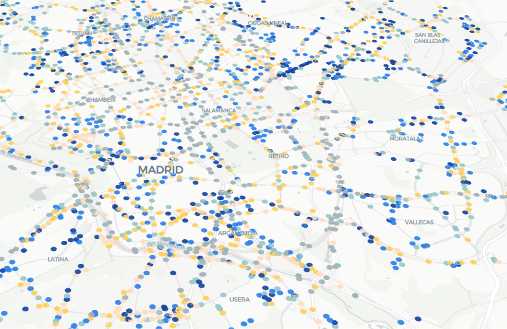

# Data preparation

The TA-ANP main experiment combines fixed-sensor observations and TomTom floating car data from the **Metropolitan Multi-Source Traffic Dataset (MMTD)** for Madrid, at 15-minute intervals during August 2024.

## Data access

**Fixed sensors.** Our experiment uses the **urban subset** of the MMTD fixed-sensor data archived on [Zenodo](https://zenodo.org/records/18781181): 2,371 urban sensors, excluding the highway sensors. Use the experiment-specific `fixed_sensor_data.h5` provided below; the full Zenodo fixed-sensor file is not a drop-in input for this experiment.

**Google Drive download: [TA-ANP-Data](https://drive.google.com/drive/folders/1nXQoiqrIHL2WpxnS1E1DnLEh5U3iQ6MW?usp=drive_link)** (prepared urban fixed-sensor data, road attributes, network distances, and the clustering CSV).

**TomTom.** Readers must apply for access to **TomTom Traffic Stats** directly through [TomTom MOVE](https://move.tomtom.com/) and obtain data for the same area and period under TomTom's terms. **We cannot redistribute the TomTom data**, and it will not be included in the Google Drive download. The acquired data must be aligned with the fixed-sensor inputs as described below to produce `tomtom_data.h5`.

## Aligning the two data sources

Both sources are bound to a common set of OpenStreetMap (OSM) road-segment IDs and a common time grid. The maps below illustrate the fixed-sensor locations and TomTom coverage in Madrid.


| Fixed sensors                                             | TomTom coverage                                          |
| --------------------------------------------------------- | -------------------------------------------------------- |
|  |  |


1. **Match fixed sensors to roads.** Associate sensor points with the lane-count layer and OSM road segments using proximity, direction, and road type. Merge co-located lane sensors and clean invalid observations, preserving missing values. This processing is already reflected in the prepared fixed-sensor input.
2. **Match TomTom roads to the same network.** Use HMM-based line-to-line map matching, with direction and overlap checks, to associate TomTom geometries with OSM segments. Aggregate them to the common intersection-to-intersection segments using length-weighted flow and harmonic-mean speed. Reuse the road IDs in `road_info.h5`.
3. **Align time intervals.** Put both sources on the same 15-minute grid, with consistent time-zone interpretation and chronological ordering. The experiment covers August 1–31, 2024. Corresponding rows must represent the same interval.
4. **Export aligned inputs.** Store observations as time × road × feature arrays in `data/values`, with `metadata/nodes`, `metadata/times`, and `metadata/features`. Shared road IDs link the sources to the road attributes and distance matrix; the two sources can cover different numbers of roads. The loader uses these IDs to map observations onto the common network.

The alignment workflow was developed in research notebooks containing substantial exploratory work and intermediate drafts. These notebooks have not been consolidated into a standalone, documented workflow and are therefore not included in the public release. Researchers interested in the alignment procedure are warmly invited to contact [Qishen Zhou](mailto:qishenzhou@jlu.edu.cn). The author welcomes questions and will respond promptly.

## Local file layout

Place the prepared inputs at these paths relative to the repository root:

```text
MadridAllinOne/
└── DLData/
    ├── fixed_sensor_data.h5
    ├── tomtom_data.h5
    ├── distance_matrix.h5
    ├── road_info.h5
    └── train/
        └── cluster_id_road_graph.csv
```

The [clustering CSV](../MadridAllinOne/DLData/train/cluster_id_road_graph.csv) is included in this repository. The main experiment uses `NPSampler1`, which reads its `node_id` and `cluster_id_road_graph` columns to form spatial batches. The data directory must be writable so the loader can save graph and scaling caches.

To use another directory for the HDF5 inputs:

```bash
export TAANP_DATA_ROOT=/absolute/path/to/prepared/DLData
```

Keep the clustering CSV at the repository-relative path shown above.
